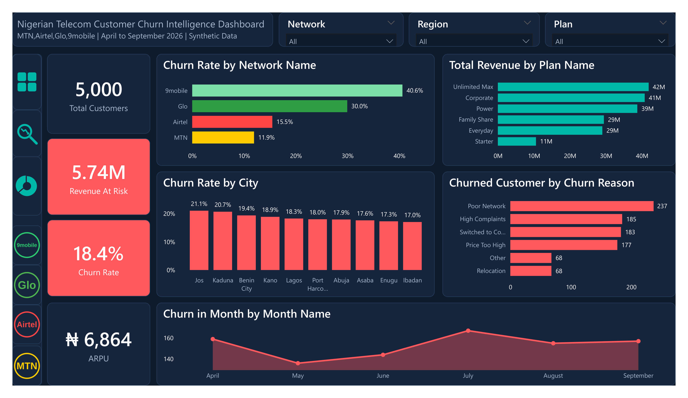
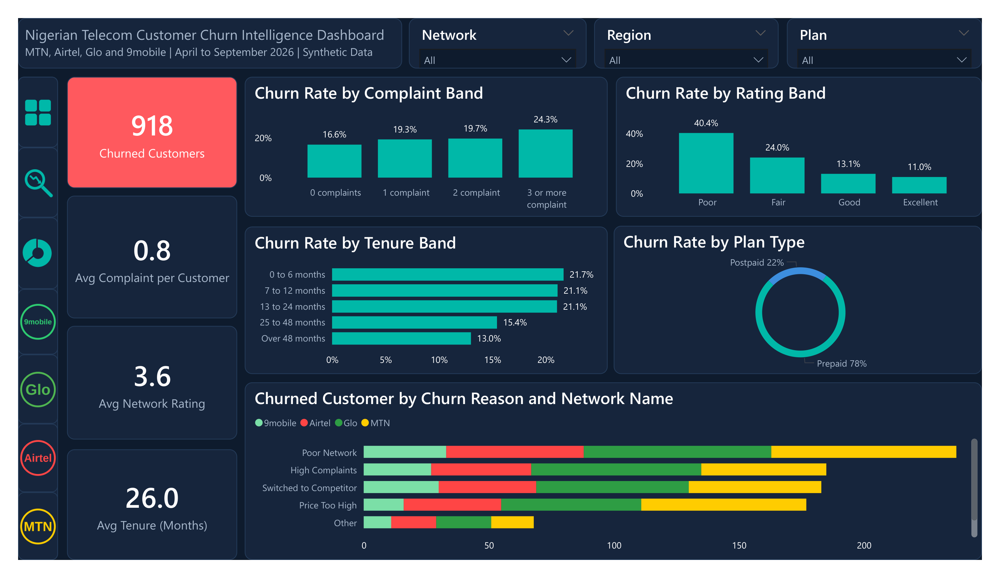
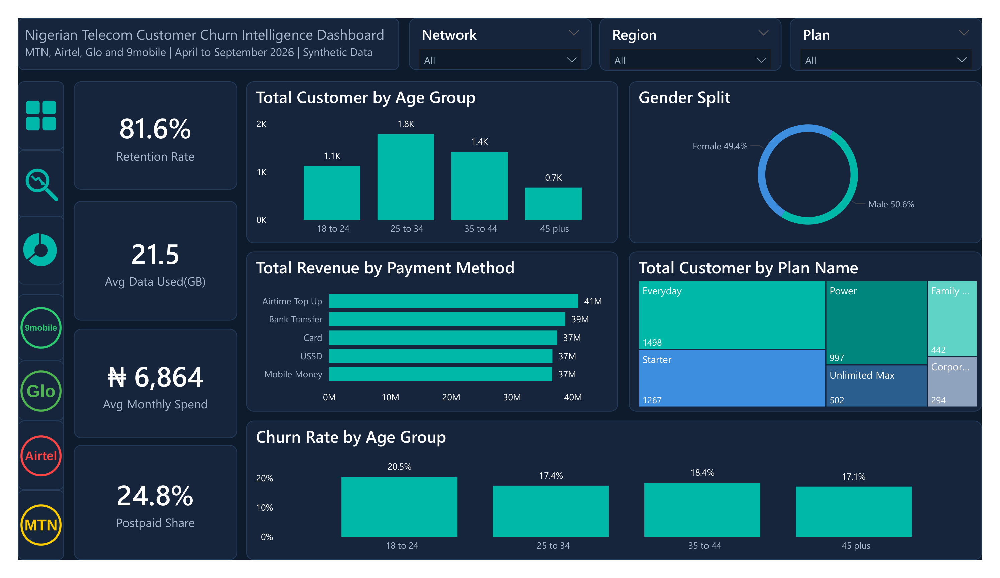

# Nigerian Telecom Customer Churn Intelligence Dashboard (Power BI)

A three page Power BI dashboard that shows why customers leave Nigerian telecom networks, how much revenue is at risk, and which customer groups to protect first. It is built on a synthetic dataset of 5,000 customers across MTN, Airtel, Glo and 9mobile, with a star schema, DAX measures, custom theme, icons and page navigation.

## Dashboard Preview

**Page 1: Executive Overview**



**Page 2: Churn Drivers**



**Page 3: Customer Segments**



## Table of Contents

1. Project Overview
2. Business Problem and Questions
3. Dataset
4. Data Model
5. Tools and Skills Used
6. Data Preparation
7. DAX Measures and Calculated Columns
8. Dashboard Pages
9. Key Insights
10. Recommendations
11. Limitations
12. Lessons Learned
13. Repository Structure
14. How to Use This Project
15. Future Improvements
16. About the Author

## 1. Project Overview

Customer churn is one of the biggest costs for any telecom operator. Winning a new customer costs more than keeping an existing one, so knowing who leaves, and why, protects revenue directly.

This dashboard turns raw customer and usage data into three clear views: an executive summary, the drivers of churn, and the customer segments. A manager can filter by network, region and plan with one click.

## 2. Business Problem and Questions

The business wants to reduce churn and protect revenue. The dashboard answers:

1. How many customers do we have, and what percentage churn?
2. Which networks, cities and plans lose the most customers?
3. How much monthly revenue is at risk?
4. Why do customers say they leave?
5. Do complaints, network ratings and tenure affect churn?
6. Does age, gender or payment method matter?
7. Who are our customers, and how do they spend and use data?

## 3. Dataset

The data is fully **synthetic**. It was generated for learning and portfolio purposes, and it does not describe any real customer, company or network. Network names are used only to label the categories.

**Size:** 5,000 customers and about 27,740 monthly usage records.

**Period:** April to September 2026.

**Coverage:** 4 networks, 6 plans (prepaid and postpaid), 10 cities across 6 zones, 5 payment methods.

**Tables:**

1. Fact_Usage: one row per customer per active month (data used, voice minutes, SMS, monthly spend in Naira, complaints, network rating)
2. Dim_Customer: one row per customer (gender, age, age group, tenure, signup date, payment method, churn status, churn month and churn reason)
3. Dim_Plan: plan name, plan type, monthly price and data allowance
4. Dim_Network: MTN, Airtel, Glo and 9mobile
5. Dim_Region: city, state and zone
6. Dim_Date: monthly date table

## 4. Data Model

The model is a star schema, with Fact_Usage at the centre and the dimensions around it. All relationships are one to many with single direction filtering.

1. Dim_Customer to Fact_Usage on Customer_ID
2. Dim_Date to Fact_Usage on Date_Key
3. Dim_Plan to Dim_Customer on Plan_ID
4. Dim_Network to Dim_Customer on Network_ID
5. Dim_Region to Dim_Customer on Region_ID

## 5. Tools and Skills Used

1. Power BI Desktop
2. Power Query for loading and typing the data
3. DAX measures and calculated columns
4. Star schema data modelling
5. Custom colour theme (JSON)
6. Custom icons and page navigation
7. Dashboard layout, wireframing and storytelling

## 6. Data Preparation

1. Loaded the six tables from Excel into Power Query.
2. Set the data types: text for IDs, whole numbers for counts, decimals for usage, and dates for all date columns.
3. Kept the blank Churn_Month and Churn_Reason values for customers who did not churn, because blank is the correct value for them.
4. Checked the row counts against the source: 5,000 customers and 918 churned.
5. Built the relationships and checked that filters flow from the dimensions to the fact table.

## 7. DAX Measures and Calculated Columns

**Core measures**

```
Total Customer = DISTINCTCOUNT(Dim_Customer[Customer_ID])
```

```
Churned Customers =
CALCULATE(DISTINCTCOUNT(Dim_Customer[Customer_ID]), Dim_Customer[Churned] = "Yes")
```

```
Churn Rate = DIVIDE([Churned Customers], [Total Customer])
```

```
Retention Rate =
DIVIDE(
    CALCULATE(DISTINCTCOUNT(Dim_Customer[Customer_ID]), Dim_Customer[Churned] = "No"),
    [Total Customer]
)
```

```
ARPU = DIVIDE(SUM(Fact_Usage[Monthly_Spend_NGN]), COUNTROWS(Fact_Usage))
```

```
Revenue At Risk = [Churned Customers] * CALCULATE([ARPU], Dim_Customer[Churned] = "Yes")
```

```
Churn in Month =
CALCULATE(
    [Churned Customers],
    TREATAS(VALUES(Dim_Date[Date_Key]), Dim_Customer[Churn_Month])
)
```

**Other measures:** Total Revenue, Avg Complaints per Customer, Avg Network Rating, Avg Tenure (Months), Avg Data Used (GB), Avg Monthly Spend and Postpaid Share.

**Calculated columns (Dim_Customer):** Total Complaints, Customer Avg Rating, Complaints Band, Rating Band and Tenure Band, each with a sort order column so the bands display in the right order.

## 8. Dashboard Pages

**Page 1: Executive Overview.** KPIs: Total Customer, Revenue At Risk, Churn Rate and ARPU. Charts: churn rate by network, total revenue by plan, churn rate by city, churned customers by churn reason, and churn in month.

**Page 2: Churn Drivers.** KPIs: Churned Customer, Avg Complaint per Customer, Avg Network Rating and Avg Tenure. Charts: churn rate by complaint band, rating band and tenure band, churn rate by plan type, and churned customers by churn reason and network.

**Page 3: Customer Segments.** KPIs: Retention Rate, Avg Data Used, Avg Monthly Spend and Postpaid Share. Charts: customers by age group, gender split, revenue by payment method, customers by plan, and churn rate by age group.

**Design:** a dark navy theme with red used only for churn and risk, teal for revenue and healthy numbers, and a fixed colour for each network. Slicers for Network, Region and Plan work across the report.

## 9. Key Insights

1. The overall **churn rate is 18.4%** (918 of 5,000 customers), and retention is 81.6%.
2. **9mobile (40.6%) and Glo (30.0%) lose the most customers**, compared with Airtel (15.5%) and MTN (11.9%).
3. **Network quality matters most.** Customers who rate the network as Poor churn at 40.4%, against 11.0% for Excellent. Poor Network is also the top reason given for leaving (237 of 918 customers).
4. **Complaints push churn up.** Churn rises from 16.6% for customers with no complaints to 24.3% for those with three or more.
5. **New customers are the most fragile.** Customers with up to 24 months of tenure churn at about 21%, against 13.0% for those with over 48 months.
6. **Age and gender make little difference.** Churn stays between about 17% and 20.5% across age groups, and gender is nearly even.
7. **Prepaid customers make up about 78% of churned customers**, but they are also about 75% of the base, so the gap in churn rate between prepaid and postpaid is small.
8. About **₦5.74M of monthly revenue is at risk** from churned customers, and ARPU is ₦6,864.
9. City differences are small. Jos has the highest churn at 21.1% and Ibadan the lowest at 17.0%.

## 10. Recommendations

1. **Fix network quality first**, starting with 9mobile and Glo, since poor network is the top churn reason and the strongest churn signal.
2. **Resolve complaints fast.** Flag customers with two or more complaints for a retention call.
3. **Protect the first two years.** Add onboarding offers and check ins for customers in their first 24 months.
4. **Use ratings as an early warning.** Customers who rate the network Poor or Fair should be offered support or a plan review.
5. **Do not target by age or gender.** The data shows they are weak predictors, so spend retention effort on behaviour instead.
6. **Track revenue at risk** monthly, so the business can see the value of every point of churn reduced.

## 11. Limitations

1. The data is synthetic, so the findings demonstrate the method and do not describe real networks.
2. The relationships shown are associations and do not prove cause.
3. Revenue At Risk is an approximate monthly figure: churned customers multiplied by their average monthly spend.
4. Network ratings and complaints are averaged over each customer's active months.
5. The six month window is short for studying seasonal churn.

## 12. Lessons Learned

1. **Do not remove blank rows blindly.** Blank churn month and churn reason are correct for customers who stayed. Removing them left only the 918 churned customers, which made the churn rate show 100%.
2. **Check row counts at every stage.** A simple card showing 5,000 customers would have caught the problem straight away.
3. **Date columns must be real dates.** Both sides of a date relationship need the Date type, or the relationship and time measures fail.
4. **Save versions often.** Ending a stuck save can corrupt a report, so keep numbered copies.

## 13. Repository Structure

```
Nigerian_Telecom_Churn_Dashboard_PowerBI/
    README.md
    Nigerian_Telecom_Churn_Dashboard.pbix
    telecom_churn_data.xlsx
    telecom_churn_theme.json
    images/
        page1_executive_overview.png
        page2_churn_drivers.png
        page3_customer_segments.png
```

## 14. How to Use This Project

1. Download **Nigerian_Telecom_Churn_Dashboard.pbix** from this repository and open it in Power BI Desktop.
2. Use the Network, Region and Plan slicers to filter every page.
3. Use the icons on the left to move between pages.
4. To rebuild or refresh the data, use **telecom_churn_data.xlsx** and update the file path under Transform data.
5. To reuse the colours, go to View, then Themes, then Browse for themes, and choose **telecom_churn_theme.json**.

## 15. Future Improvements

1. Add a churn prediction score with a simple model, to rank customers by risk.
2. Add a drill through page that lists at risk customers.
3. Add month on month trends for each network.
4. Publish the report to Power BI Service with scheduled refresh.
5. Add what if analysis: how much revenue is saved if churn falls by one point.

## 16. About the Author

**Omobolaji Kehinde Zachariah (Bolaji)** is a data analyst and BI specialist, and a teacher turned analyst. He breaks down complex problems into simple, step by step explanations and builds projects in public.

He also runs **The Analytics Ladder**, a free WhatsApp community for aspiring data analysts in Nigeria.

1. Portfolio: [komobolaji20-droid.github.io](https://komobolaji20-droid.github.io)
2. GitHub: [github.com/komobolaji20-droid](https://github.com/komobolaji20-droid)
3. Email: [komobolaji20@gmail.com](mailto:komobolaji20@gmail.com)

If you find this project useful, please give the repository a star and share your feedback.

